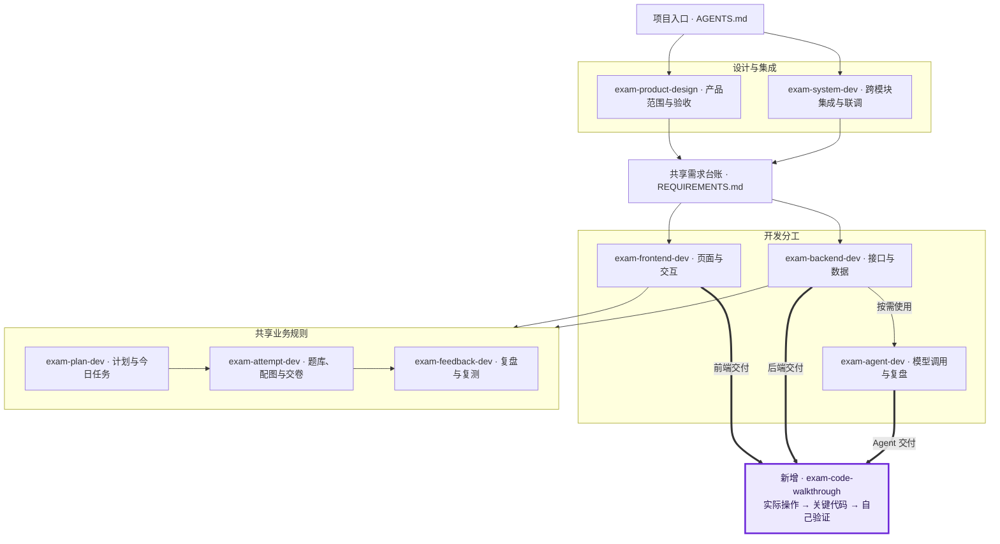

# 个人考公软件

面向个人使用的考公备考系统，围绕计划、作答、AI 复盘和复测开发。

## 项目技能架构

前端与后端在各自对话中开发，共用需求和接口约定。Agent 在后端内运行。三类开发交付都使用代码导读技能，沿一次实际操作带用户找到关键代码并验证效果。

- [项目规则和技能入口](AGENTS.md)
- [需求台账和首版联调约定](REQUIREMENTS.md)
- [开发代码导读技能](skills/exam-code-walkthrough/SKILL.md)
